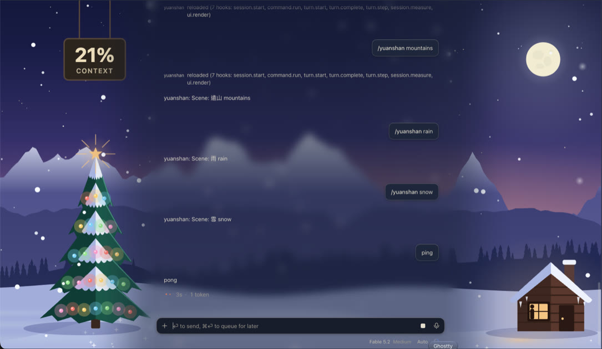
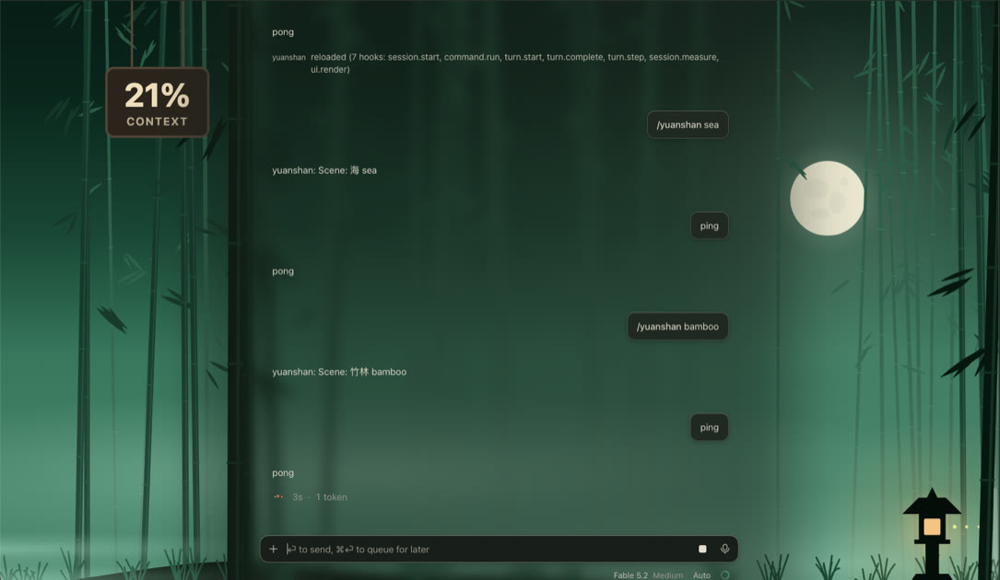
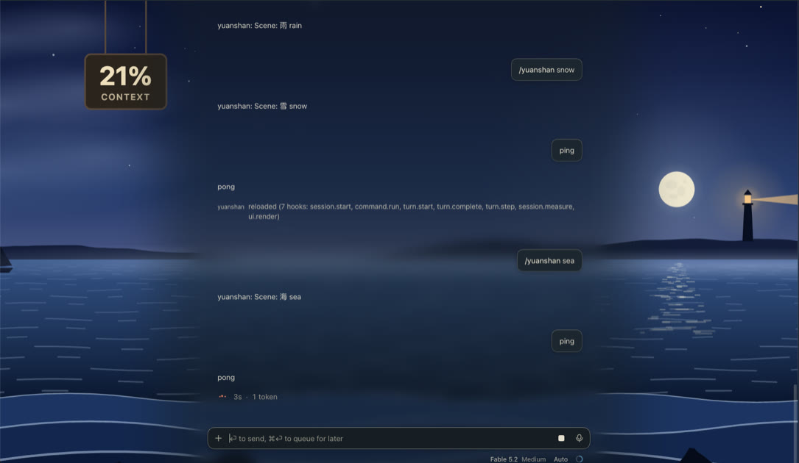
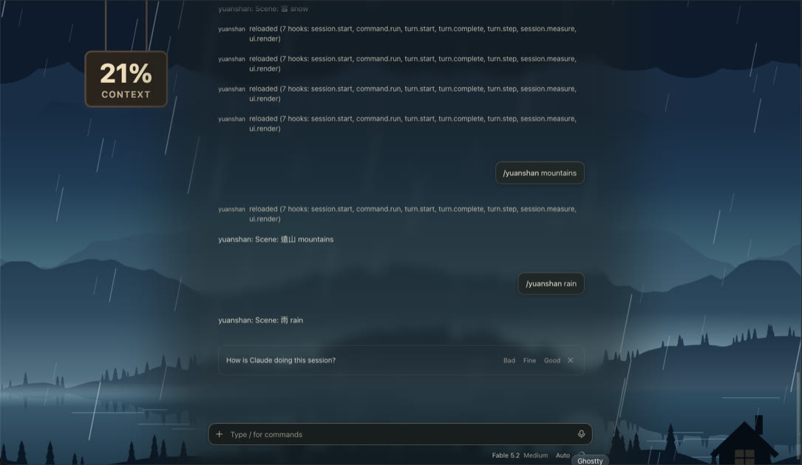
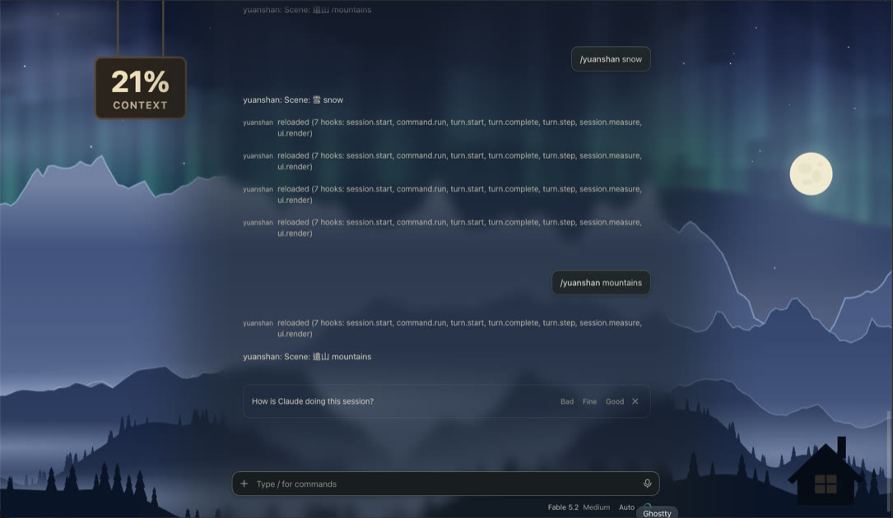

# 遠山 Yuanshan

Five animated backdrops for Claude's desktop and mobile apps, each with a matching colour palette for light and dark mode. The scene reacts to the session:

- **Context window**: a hanging sign shows how full it is, and the scene changes with it (snow piles up, rain thickens, the moon climbs, fireflies come out).
- **Working**: while Claude works a lamp is lit — the cabin window and the lights on the pine, the lighthouse beam, the stone lantern — and the weather picks up.

| Scene | Command | |
| --- | --- | --- |
| Snow 雪 | `/yuanshan snow` |  |
| Bamboo 竹林 | `/yuanshan bamboo` |  |
| Sea 海 | `/yuanshan sea` |  |
| Rain 雨 | `/yuanshan rain` |  |
| Far mountains 遠山 | `/yuanshan mountains` |  |

`/yuanshan` alone lists the scenes; `/yuanshan off` and `/yuanshan on` turn the look off and on. The choice is kept across sessions.

## Install

At the prompt of a terminal session:

```
/plugin install yuanshan --marketplace zjlgdx/claude-theme-yuanshan
```

Answer `y` to add the marketplace, then choose a scope.

From a shell:

```
claude plugin install yuanshan --marketplace zjlgdx/claude-theme-yuanshan
```

In the desktop app, where `/plugin` does not run: click + next to the prompt box, then Plugins, Add marketplace with `zjlgdx/claude-theme-yuanshan`, then Add plugin.

## Notes

- The backdrop is drawn in the desktop and mobile apps only; the terminal draws no look.
- Every scene is one SVG animated with CSS alone, as the app requires: no script, nothing loaded.
- With "Reduce motion" on, the scenes stand still.
- The scenes look best in dark mode.

## Developing

Scenes live in `hooks/scenes/`, one file each; `hooks/scenes/shared.ts` holds what they share. `hooks/make-colors.js` is copied unchanged from Claude Code's plugin-authoring skill.

```
claude plugin validate .
claude --plugin-dir .
```
